Last weekend, Melbourne had [Revitalize](https://www.revitalisewcs.melbourne/), its first West Coast Swing [World-Swing-Dance-Council](https://www.worldsdc.com/) (WSDC) sanctioned event in 7 or so years. It was a raging success, and it heralds a new chapter for West Coast Swing in Melbourne. At over ~240 participants it may be the largest Australian event of this year!

Why has it taken many years for the second-largest city in Australia to host an event? What marks this moment as a "revitalisation" of the Melbourne WCS community? Well sit down dear reader and let me tell you a tale, a tale I have uncovered over this last year...

  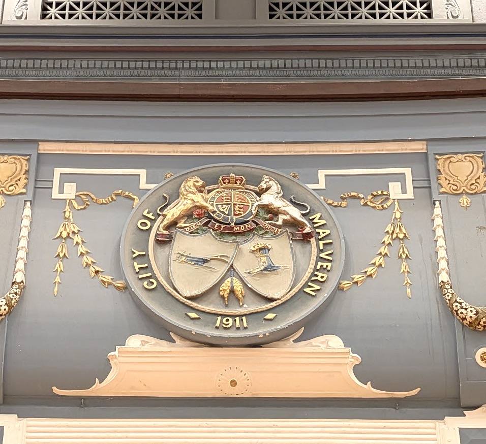

### Where do we begin?

Let us start first, with the faithful narrator of this tale; me! Many years deep into my Californian exile, the longing for home grew uncontrollable. As my heart ached for the smell of eucalypt, the kookaburra's laugh, and the dignified twang of my country-people (Yea, nah, yea naaah yea), my eyes and heart cast their gaze back over the Pacific. Dance has always been a respite, a reset, a revelry; and now that I was looking to leave my past life chapter behind, I knew it would be an important facet of coming home. I wanted the camaraderie and community that comes with dance, I wanted the physical, creative and emotional release that dance gives me and I wanted it as my guiding star in this period of life-transition.

In saying good-bye to California, I was also saying good bye to Hustle, the partner dance I had grown the most with over my time in California. My very first dance event on the scale of Revitalize was the LA Hustle Congress, in October 2023. I had been dancing hustle on and off for about seven years at that point.

> I *did not* realise how these dance-convention-style weekends were sooo much more of what I wanted out of a big weekend adventure than a lot of the other things I had tried.

While realising this, I was researching and thinking more and more about returning to life under the southern stars. I found that there was some Hustle in Australia but the community was very small. If I wanted to more readily go deeper into partnered dance, I would have to look elsewhere. West Coast Swing was an obvious choice, although Zouk would have been a viable option as well. Like Hustle, West Coast Swing was slotted, lead/follow, improvisationally focused dance, that was danced to contemporary music. And importantly, there was an [obvious list of WCS events](https://www.worldsdc.com/events/), with a good selection of Australian and New Zealand events available.

So a month after the LA Hustle Congress, I was lucky enough to find a WCS community when I was staying in Buenos Aires for a month, and the journey into WCS began in earnest.

  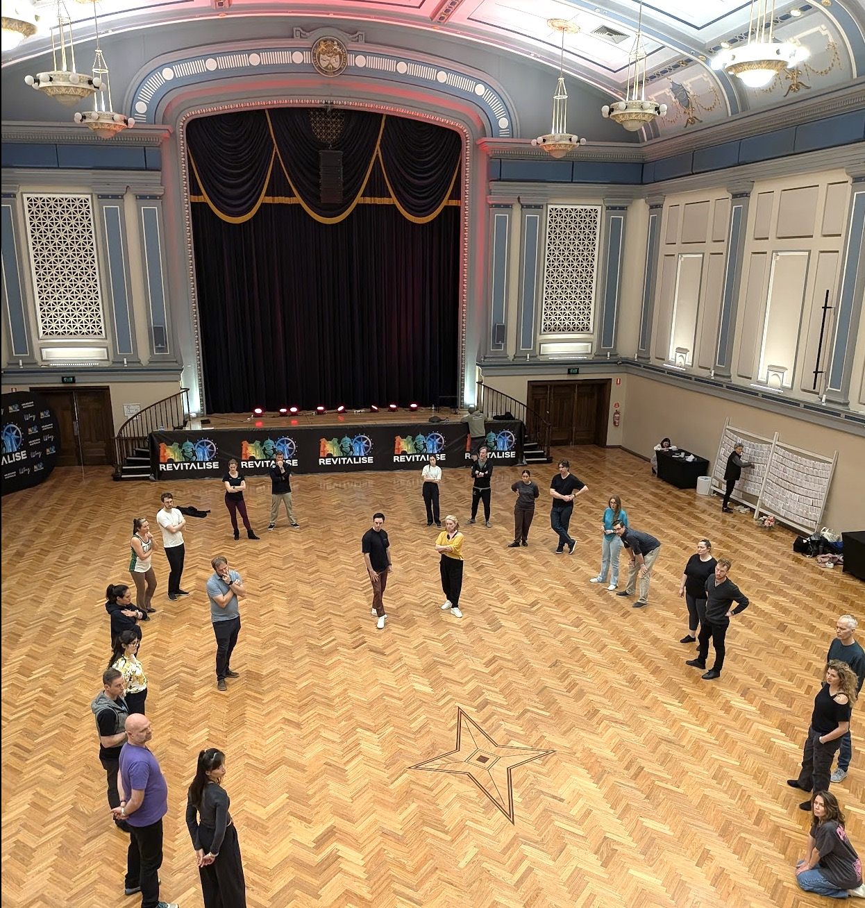

### Weren't we talking about Melbourne?

Ahem, yes, yes, yes... During much of 2024, I was exploring the fantasy and the reality of calling somewhere new in Australia and New Zealand home (Love you Canberra, but you didn't make the short-list). I was first in Melbourne at the end of 2023 but almost my whole two weeks there was impacted by getting covid. It took until August/September 2024 before I would get another bite at the apple.

At this point I had visited maybe half a dozen cities where I was pondering what life and dance would look like there. Even if I wasn't considering living in a place, it was always curious to hear about the history and evolution of dance communities in that city. I had gotten to hear some of those stories from cities like San Francisco Bay Area, Los Angeles, Buenos Aires, Tokyo, Brisbane, Auckland, Wellington and arriving in August '24, I started learning about Melbourne.

  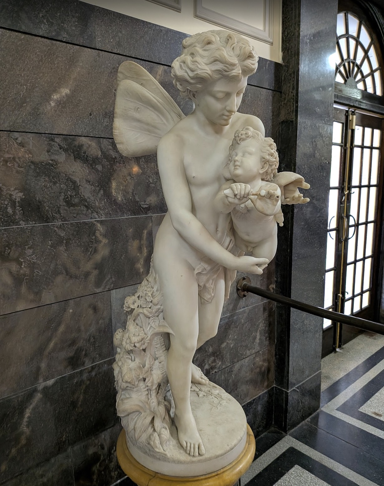

Melbourne is vast; something like 5 million people, and spread out over a wide expanse, in Kulin country. Sometimes you encounter big cities that have under-sized dance communities, and when I arrived it felt like Melbourne was like this for WCS. Los Angeles is actually an example of this for West Coast Swing, despite being the crucible the dance emerged from! What I have come to find is that density, not just population, is more important as a pre-condition for a strong/large dance community. Also, I had been in dance communities that had suffered from division, and unsurprisingly that impacts the quality and enjoyment of dance in those spaces. So I am always curious to understand the character of the communities I encounter:

> Who are the community leaders, whether they be those running schools, inspirational dancers, behind-the-scenes organisers or stewards of dance culture?
>
> What are the relationships between those individuals and clusters of dancers?
>
> What is driving the engagement of the community leaders (Love, ego, obsession, money, inertia)?
>
> What is driving the dancers of that community? Is this just a casual social hang experience? Are they deeply mastery focused? What aspects of dance do they love?

With Melbourne, I noticed that the Melbourne schools and most of the dancers were pretty newish. Yes, the instructors had been around the Melbourne WCS community for much longer (and had experienced the Melbourne WCS scene pre-pandemic) but the overall scene was very fresh and new. Of course, a lot of dance communities suffered over the pandemic years but it felt like Melbourne had undergone a full reset for WCS. It was obvious early on that the different schools were engaged in a very collaborative way; not just pretending that the others didn't exist but actively linking to each other.

  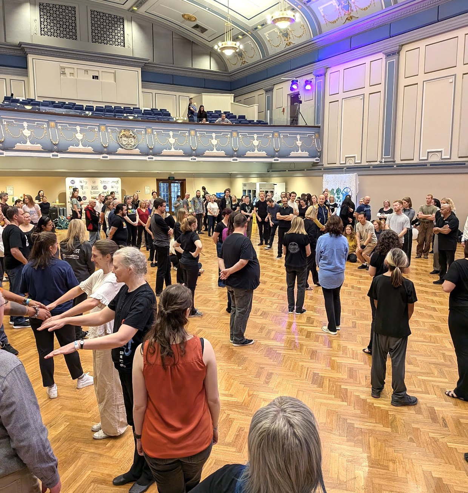

On top of that, while the raw numbers of dancers felt pretty low for the size (and density) of Melbourne, it felt like there was great opportunity for growth. I saw the scaffolding of a wider community; the community leaders beyond just the school founders. Whether it was that passionate dancer that kept bringing new ideas and energy into the community, or the social organiser that made non-dance moments happen or the cadre of dancers taking their first steps into teaching classes, there was a good core for the community to grow around.

> There was only one sinister revelation at this time.... discovering that an overwhelming number of active community members had a connection to New Zealand! But woe befall us all, your dear narrator also realised that as a kiwi passport holder (thank mum!) they too were de facto part of this unspoken conspiracy.

### More history revealed

As late 2024 progressed, for reasons inside and outside of dance, I settled on Melbourne as my anchor point for my life back home. As the months went, and ticking over into 2025, I started learning more about the history of West Coast Swing in Melbourne. Occasionally, I would hear tales of "the before times", from folks that were dancing in the community prior to the pandemic. It turns out it was more than the pandemic that laid the Melbourne WCS scene low; there had been some community divisions (not uncommon for larger scenes), a bungled major event and a school re-opening and closing scandal.

  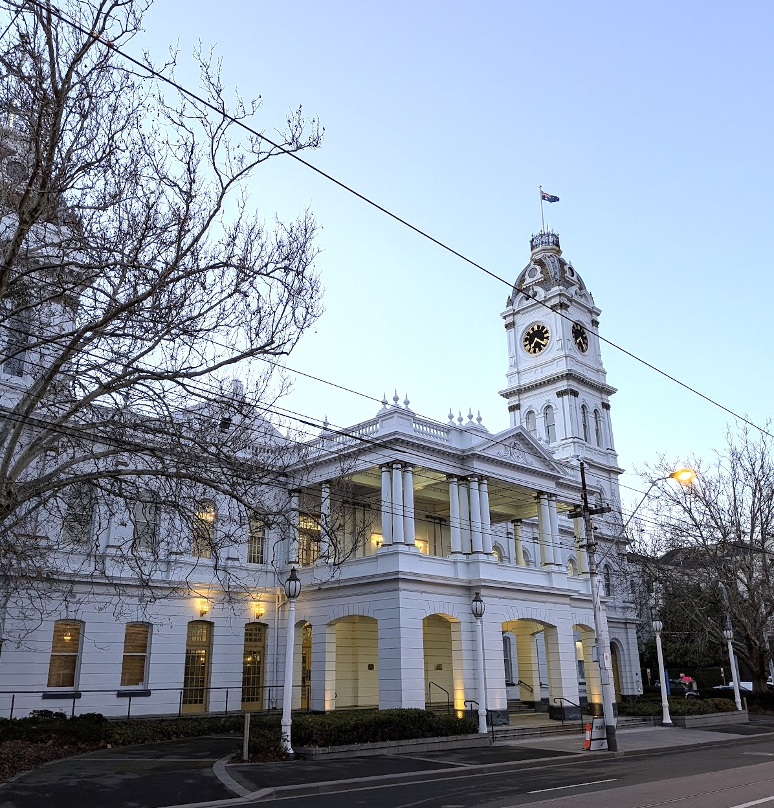

I do not have all the details, nor recall the names of the various parties involved but the bungled event and the school shenanigans were organised by the same school founders (unassociated with any of the current schools), and that sequence of events burnt a lot of trust across the community and turned many dancers away. I do not have the knowledge nor inclination to do a detailed breakdown of what happened in the past but I note it here to put it on the record; when humans gather, it takes effort and stewardship for it to go well. When you experience it going badly, you get real grateful for when it goes right.

The pandemic response in Melbourne was full-on and at times very lengthy. I'm glad I wasn't here to experience it personally. It has also been a composting of the WCS scene in Melbourne, after the difficult years prior to 2020. With careful stewardship, passion for the dance and an incredible amount of effort, the current school founders and instructors have created something precious here in Melbourne. Revitalise has really brought those efforts into focus, in a way that has really made a statement about Melbourne being 'back' in the wider Australian WCS scene.

### The event itself

At some point leading up to the event, Janine or Brady, the event hosts, mentioned that more than 80 folks from Melbourne were signed up. I was stunned; who were these people? I was expecting 50-60 of 'us' at most. Over the weekend there were several times when I asked someone I hadn't seen before where they were from and they said Melbourne! The event had inspired a few Melbourne folks from the before-times to come back out and touch in with the WCS community. That felt important; like a wider reintegration into the past WCS community in Melbourne.

  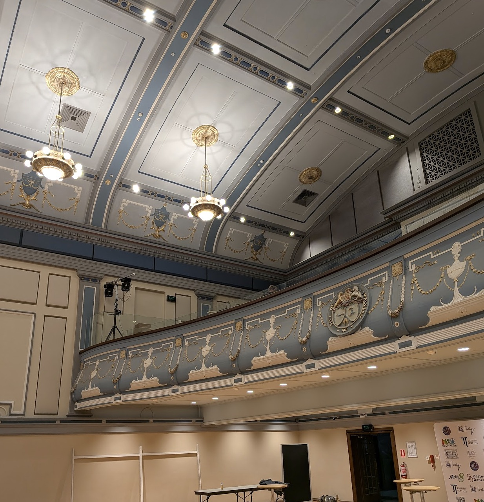

Friday, the first day of the event, was the first time I had seen the Malvern Town Hall, inside or outside. And I was floored. It is such a stunning venue, such a refreshing change from the constant of the hotel conference ballrooms I had now seen time and time again at other events. Revitalise had the highest sticker price of any dance event I had attended; to me, the venue alone made up for that higher price.

By the end of the first night, I already felt it; I already knew that this was a real moment in this community's history. I was on a dancer's high, running around dancing and hugging folks. My energy had the madness of someone running around, grabbing people's attention and exclaiming "It's happening!!!" before dashing off once more. There are so many little things that can drag us away from noticing something happening in the moment; I was euphoric to have that all fall away and be present to what was happening.

There are too many facets of the weekend to cover here but short to say, I am left with a profound sense of gratitude for all of the people that have brought Melbourne West Coast Swing to this point

  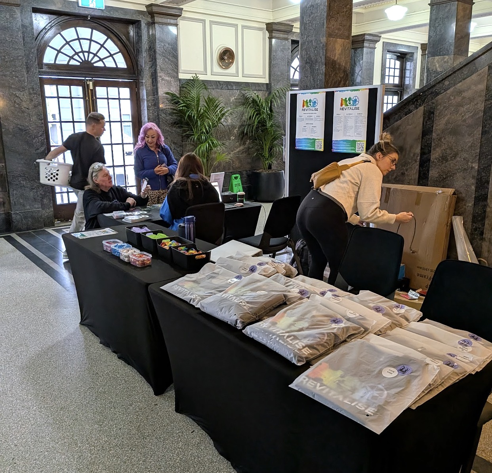

### Gratitude

To begin, Janine and Brady had the vision, the determination, the connections and the gumption to host this event and "Put Melbourne back on the event calendar". Their skill-sets and efforts compliment each other so well and they pulled together a great staff, who in turn pulled off such an amazing complex experience for all of the participants. On top of that, they also hold court on Wednesdays in the Deep East of Melbourne, growing the West Coast Swing community in Melbourne every month, and they ran extra classes to ramp our local dancers up for the event.

As Brady mentioned during the event wrap up, Revitalise put Melbourne back on the calendar, but Chris and Jacqui have put Melbourne back on the map for West Coast Swing. Now the longest running WCS school in Melbourne, Chris and Jacqui hold down Monday nights in the inner North of Melbourne, and organize the monthly social dance at La Encantada in the city. We are blessed that they (with a few other hardy souls) kept WCS in Melbourne alive post-pandemic, and in doing so, created the opportunity for WCS to return in earnest to the city.

  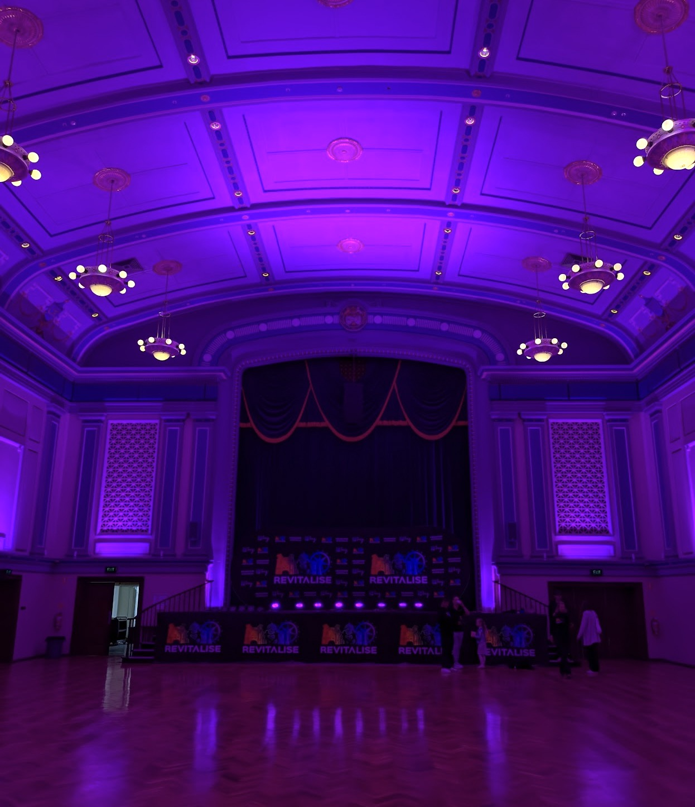

In the lead up to Revitalise, a competition practice squad was formed. Janine, Brady, Jacqui and Chris were joined by Ed and Luci, as the instructors and guides for the squad. On top of everything else, these folks came together to workshop and coach almost all of the Melbourne dancers that were looking to compete during Revitalise. The pace of practice, with there being five days of classes or workshops a week, for almost six weeks leading up to the event, would normally be unsustainable.

But to have our local event coming up, it was the perfect motivation for the community to push deep into mastery. The gains across the community were evident. It is a rare opportunity for such an effort to be made, and I am so grateful to have gotten to learn and practice with the squad. Thank you all for your dedication, it really means so much to me that y'all made this happen.

Turning to the wider community, we also have several other schools teaching WCS, including Li'Rann Dance out in the West of the city and Motiv8 and Destine Dance in the South-East. This creates more opportunities for nights of WCS in Melbourne, and broadens the geographic spread that the dance has through this vast city. Thank you all for spreading the love of this dance and making the Melbourne community so much richer.

  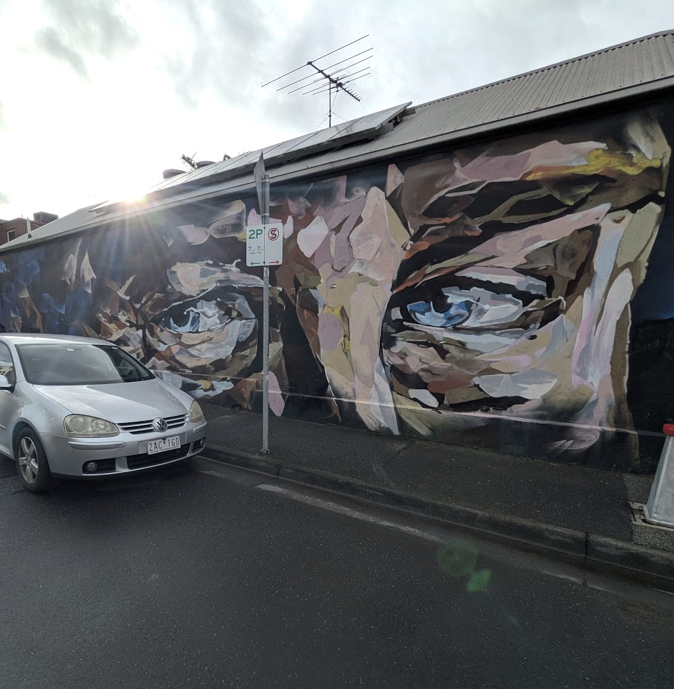

There is a great core of other community stewards, our experienced dancers that we look up to, and who also chip in on instructing. Kieran, Jody, Mel, Ed and Luci, I have mainly experienced your wisdom via dance lab and I'm really grateful that we have that space to play and tinker with our dance. And Alessandra, thanks for holding it down with the new dancers, it's been really fun to dance with you more over the last few months, now that you can dance more.

##### Finally, the community of dancers as a whole.

To all you beautiful dancers out here, I am so grateful to have shared the dance floor and classes here with you. I can sit here and reflect on each of you and just feel into the little moments of joy we have shared and created since I've moved to Melbourne. Several of you shared beautiful 'warm-and-fuzzy' notes for me on the envelope wall at Revitalise, and it made me wish I had put my name on my notes and written even more! It fills my cup to think of all of our dances and adventures to come. And thanks to Mia for being the only person to notice (and comment!) that I got my hair-cut for Revitalise 😂

Beyond our beautiful local scene, Revitalise was an opportunity to reconnect and cherish dance friends from across our region and beyond. 
- Of course, Jordan and Tatiana, 20 years of coming to teach in Australia is an incredible testament to your love of the dance and generosity of sharing; Thank you for your enduring contributions. 
- Clara, it was so fun to be the book-ends of your time here in Australia. At some point you mentioned that you weren't focusing on dance while you were touring Australia, but I'm so glad you did tweak your plans just a little bit to fit us in. You'll always have a place with us here under the southern stars. 
- Rob, its always great to see you on the dancefloor, and fun to pair with you during jack-n-jill. I am trying to spruik my 3D printed badge whereever I go!
- Kat, thank you for coming to Melbourne to teach us before Revitalise, for flying the Tassy banner high and for bringing your infectious joy. I can't wait for us Melbourne folk to flood into Hobart for Southern Lights next year. 
- Zaddy, I've loved being your international cheer squad over this year. Even though Lolli (the cat) chased me out of town, Brisbane will always be my first Australian WCS home. I hope I can get up there for a decent chunk of time over the next year. 
- There are so many more faces and moments flashing up for me as I reminisce; I hope we get to dance again soon!

### Thats a wrap folks

I wanted to write this because there are so many hidden histories of communities and cultures happening all around us. For example, I could write a mini-version of this for the Hustle community in Tokyo, for whom I have much love. Who is writing these stories down, who is celebrating our joy in these strange times? 

  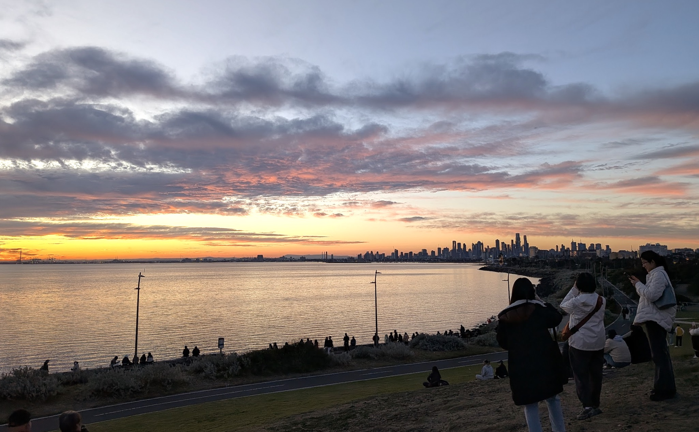

I am grateful to those who have shared stories of dance history, [Robert Royston](https://www.roystonmethod.com/) (WCS) and [Abdiel Jacobsen](https://www.justabdiel.com/) (Hustle), being two names that spring to mind. Hustle and WCS are the evolving grand-children of the USA partner dances of the first half of the 20th century, forged by Black American dancers and musicians (and with Hustle having a Latin co-parent as well). There are still so many stories untold about how we got here but I am grateful for the ones that I know.

I have been in all sorts of roles in passion-driven communities; I know how much work goes into making these moments happen. And when it is happening, I want to celebrate that, and say to you stewards, contributing big or small, that I see you. There are so many more people that I want to name, whose efforts I see and value; I just hope I get to squeeze you soon.

Thanks for reading, and catch you on a dancefloor soon ❤️

  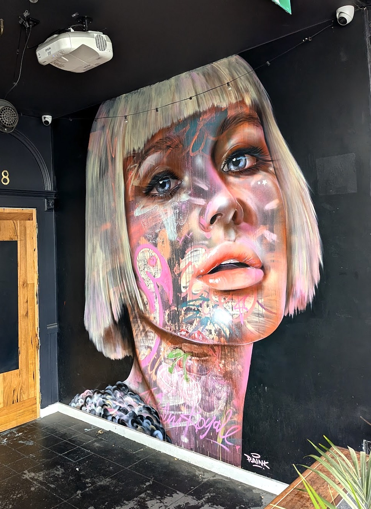
