Over the course of ten weekends, I undertook a grand west coast swing Odyssey; eight weekends' worth of wcs events in ten weeks. Swingsation, AUS; Festival City Swing, UK; Crossflow, Berlin DE; D-Town Swing, Düsseldorf DE; Neverland Swing, NE; WOTP, FR and as all good Odysseys involve, a final showdown back home, at Revitalise in Melbourne.

I return, all limbs still attached, much wiser, thoroughly danced and with a lighter wallet...

Here I share some reflections and musings about my trip, which are de facto bait to force people to look at a few photos from my trip :)

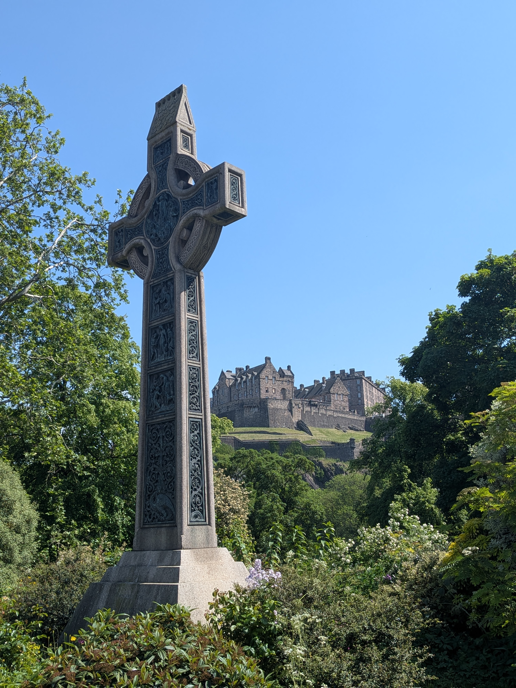

I am fortunate enough that I can work remotely; so while I am in a position to do longer dance sojourns, I'm going to take the opportunity. Last year's "Nordic Triple" of Finnfest, Mooseland and the Norwegian Open really convinced me that the density and variety of events in Europe make it the best destination for such antics. Plus, like last year being my first time to any of the Nordic countries, there are still so many places I haven't been to, and this trip took me to Scotland, France, Belgium, and Western Germany for the first time.

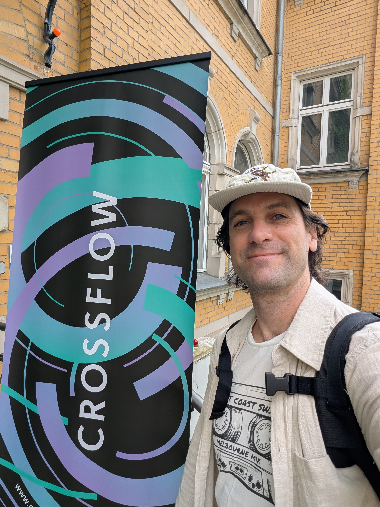

## Crossflow

The anchor of this trip was Crossflow; pulled together by Emeline and Jakub, and inviting the dance cultures of West Coast Swing, Zouk, Tango and Contact Improv to come together. Once I heard about this event, I kept pondering how I could make getting to Europe for it happen...  What started as just Crossflow certainly blew up beyond what I had initially expected, to a seven week trip. The addition of WOTP contributed a lot to this expansion.

Such was my conviction that Crossflow was going to be a special event, I committed to the trip without a workshop pass (they sold out for the WCS track almost instantly). I hoped it would all come together, and a few weeks before the event, thankfully it did when I joined the Berlin WCS facebook group just as a couple were offering up their workshop passes.

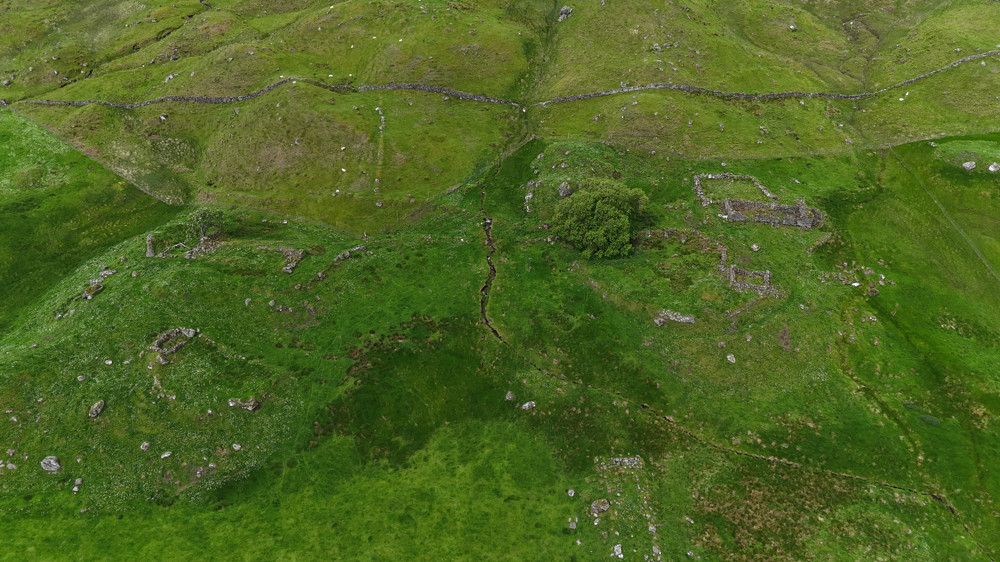

> In the end I'm so glad I committed to Crossflow because it really felt like being a part of a special moment in time to be there at the first iteration of the movement

This was my first large WCS event *without* comps or the requirements of a WSDC event. This was quite freeing in a way; the schedule seemed more spacious, and fewer hard choices were required to pick how to prioritise my time. The pedagogy was largely this: 45 minutes with pros from another dance culture sharing a concept from their movement, and then 45 minutes with pros from your own dance culture bringing that into your dance's context. I really loved that.

I was in the middle tier of WCS peeps, and we were most frequently guided through our dance journeys by the "titans of Brazil", Igor and Fernanda. It was my first direct experience with them and they were flat-out fantastic.

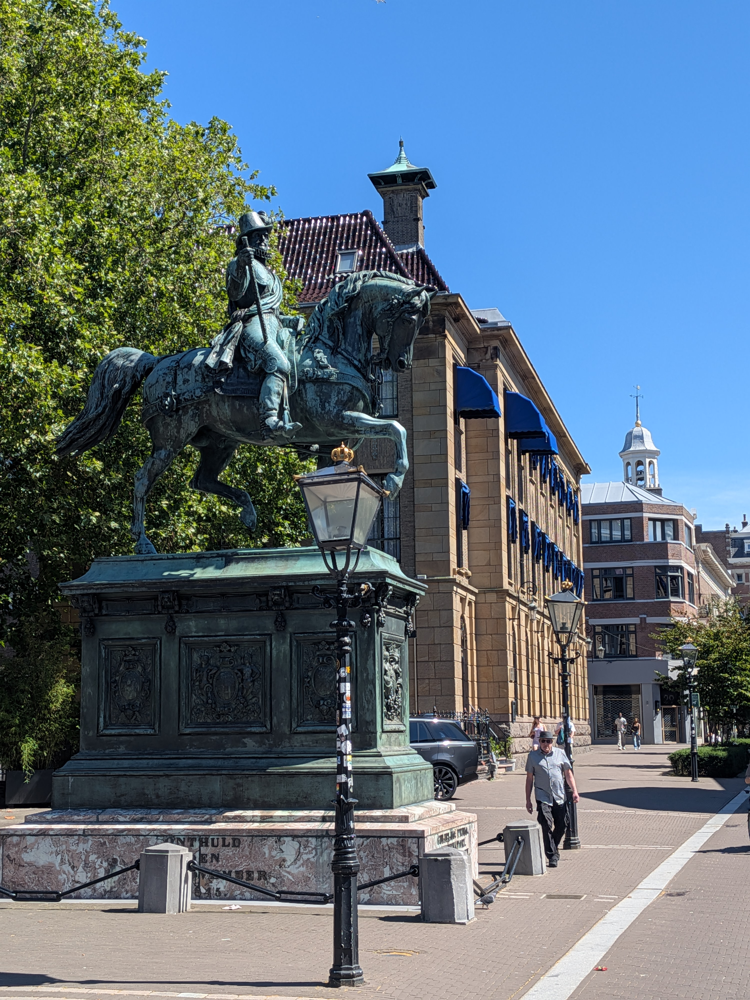

But the real mind-bending aspect of the whole event was just the atmosphere and energy of such a curious collection of movers. Brought together with an openness to experiment and play, so many 'givens' of our respective cultures had to be let go of; were we dancing just one song together, or two, four or more?! And forget about everyone dancing on a slot, it's time to hone your floorcraft like never before, as couples spiral and arc all around you. Wait, this music isn't the bpm/genre I'm used to... too bad!

Beyond the named dance cultures, there were also Lindy, Balboa and Forro dancers that braved the experience. WCS champions joined the cohorts as students, wading into the dance melee of a twelve person contact improv jam. It was a delicious chaos, one that will stay with me for some time.

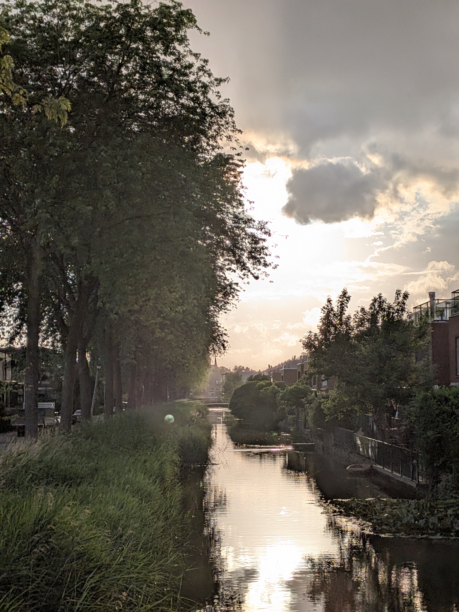

Early on I recall walking past Emeline as she was sweeping the event lobby with a broom, and struck by the thought that surely she had more important things to do, offered to take over. Only to be shooed away, "No no, this is your time to enjoy". Like frenetic parents, they dashed about all weekend, curating and hosting. But wow... to arrive at the end of this experience, and to have the creation of a hallowed space and time, with a vision set forth and brought into being... Massive kudos goes to them, the incredible teaching staff and the operational staff. I left with the irrational compulsion to return next year, however impractical. I was the participant that had travelled the furthest to attend, lured by their siren song. A fitting inclusion on a good odyssey if you ask me. I sincerely hope that they can offer Crossflow over two weekends in 2027.

## Snippets

WCS events are generally lovely because the WCS community is generally lovely. Paradoxically, that makes it harder for individual events to stand out on community metrics. I enjoyed all the events I went to, met so many lovely dancers and... the predictability of the schedule for WSDC events creates a familiarity of routine that is both comforting and unremarkable. Just another feature of our events that makes it harder for different events to stand apart and offer a distinct experience.

#### Some idle banter on perceptions in the WCS community

> "Europe WCS is so competition focused"

I heard this statement from someone and I was a little surprised... was it? Compared to who/where? Even though I've got to dance at events in the USA, Europe and Australia/NZ, I still feel like I don't have a clear view on this sort of comparison across communities/continents. Europe has many great non-comp events; surely that means that the community is more social dance oriented? But I could also see that in such a large population of dancers (like in Europe), if there was a strong focus on comp dancing, it could actually create demand for non-comp spaces as well, and that (perhaps) US events happen to have more in their schedule to cater for the different focuses across the community. In Australia, we have such a skinny community that all of our events more or less have to try to cater to all the different focuses. Sadly that means some nights the social dancing is quite limited :(

> "What are the differences between dancing in Europe and here?" or "Folks from US/EU say they can go to <opposite continent> to harvest points.."

Of course, dancing in Europe is different from Australia, from the USA, from Asia, etc. But really all these big regions are just a constellation of westie communities, each with their own quirks and traits. Yes, broadly connection is a bigger deal in Europe, but as an Aussie, that is overshadowed simply by the SCALE of the community. There are just so many more dancers, and thus, more variety, more of everything. 

I always think it's a bit silly when someone makes a huge generalisation like "We can go to the USA and harvest points", like the standard in Europe is higher. Partly it's silly hubris but also, if you go to a specific sub-region in the US, maybe you would do well competitively. But, like in Europe, there are lots of regional differences. For example: While I didn't try it this trip, I expect that if I entered a JnJ comp in France that I'd be eaten alive by teenagers, because they have a gun juniors program. For JnJ so far this year, I have got into a final and two alt-thirds in Europe, and back in Australia, a final, an alt-1 and a 'knocked out in prelims'. So maybe Australia is more competitive after all ;P (no, I just think the judges generally whiffed it on the prelims knockout at that one event).

Partly the same is true for continental comparisons; when you compare "Europe to US" are you really comparing French WCS to Texan WCS or Romanian to Californian? You'll get more specific answers by going deeper.

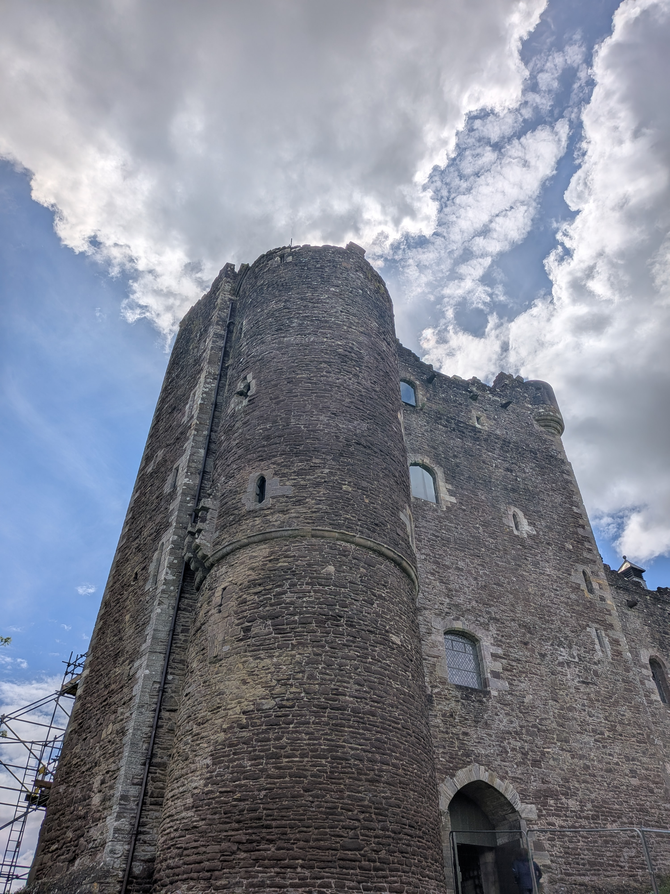

## HEAT

I got cooked at a couple of Euro summer events and as others in a [related facebook thread](https://www.facebook.com/WestieDiscussion/posts/pfbid0g8Y8rvDNK8whWNLy9TU8At75m5cRzzwXwieyP5i5fYtnZ5KuhV8SUsbrKwYjnNUel) mentioned, it's a mighty big negative for the idea of returning to such events.

There are long-running European events that are going to struggle to get the numbers they once did because of this issue. Typically (not universally!) USA events have more options for AC ballrooms. And Asia/Australia either don't run events in summer or otherwise are in hot-humid climates where this has always been a problem (and thus venues solve for it). New European events have more options, since they can pick their first venue/time-of-year while factoring in the realities of climate change.

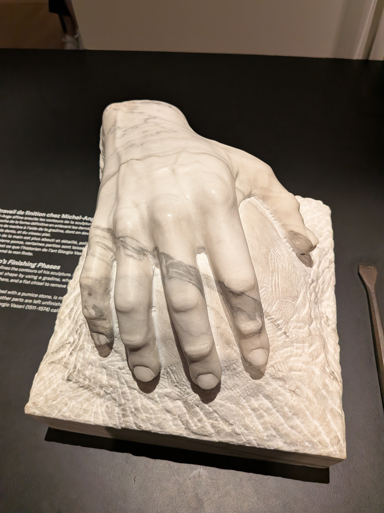

It is specifically the long-running summer European events that are going to increasingly face this issue, since heatwaves are already more common in the 10-15 years from when they first ran.

There are no easy solutions for these events:
- Often there are not compatible alternative venues
- Staff don't necessarily have experience with tinkering with ad-hoc climate-control solutions
- Is there budget for extra fans etc?
- Can you move to a different time of the year? Well, you'll be super lucky if your pros are available then!
- It is unlikely that Europe's built environment will radically shift in the coming decade. Venues are unlikely to get retro-fitted with the right systems anytime soon or consistently across summer events.

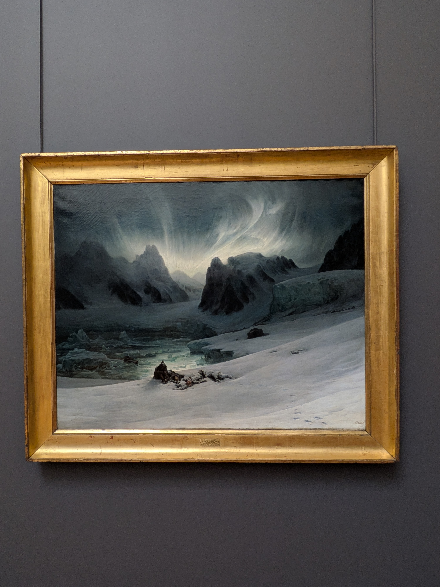

One event that fits this description has allegedly gone from close to a thousand participants down to ~800, down to ~600. 
At some level, the dancers (the market) will signal when it's too hot by not coming back to events.... and those event directors might be forced to figure out a change. I just hope no one gets serious heat-stroke before it gets to that.
In the meantime, I recommend finding someone to get you an invite link to [YourDanceBuddy](https://www.yourdancebuddy.com/) and read up on event reviews and seeing if they mention how hot folks are getting.

## WOTP

Folks had mentioned that WOTP was one of the best events on the WCS calendar and I absolutely loved it. A week, in France, on the Mediterranean. Wake up, eat, workshops, dinner, social dance, sleep, repeat. Another non-comp banger event, with a spacious schedule. And, unlike the last few events I had been to, WOTP had adequate AC (still not the best but after getting melted several times, I was incredibly grateful).

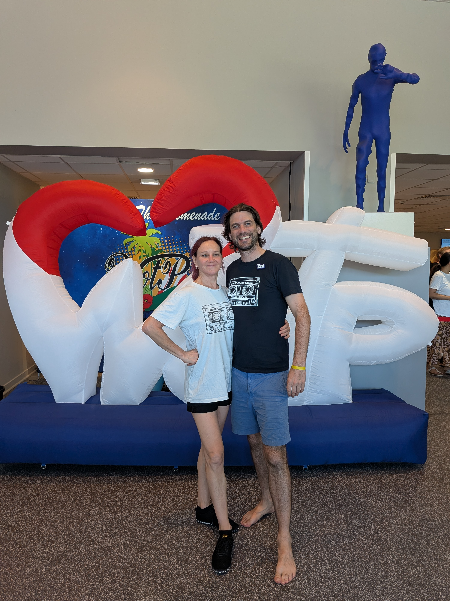
Non-staff Aussies at WOTP

At this stage, between the Nordic triple in '25 and the earlier parts of the Odyssey, WOTP included a host of familiar faces, and I had a ball dancing the week away. The participants were mass auditioned into NINE different levelled groups over four hours (the process was a bit mysterious, by design and a good opportunity to practise surrender), with a few adjustments and tweaks during the first day of instruction. It was kinda fun to figure out the structure of it from the inside, with auditions for the lowest and highest levels converging into the middle bulk of the participants getting sorted in the final part of the process. Like at D-town, I received audition blessings from Maxime, although it was later explained to me that in the WOTP case, he had given me and a range of dancers a demotion sticker, thinking it was a promotion sticker, and the other pros had to skip around pulling stickers off bemused participants!

We don't get this extent of levelling at Australian events (it requires a scale we don't currently have) but when the whole group is at such a similar level, it does make for a very targeted and consistent teaching environment.

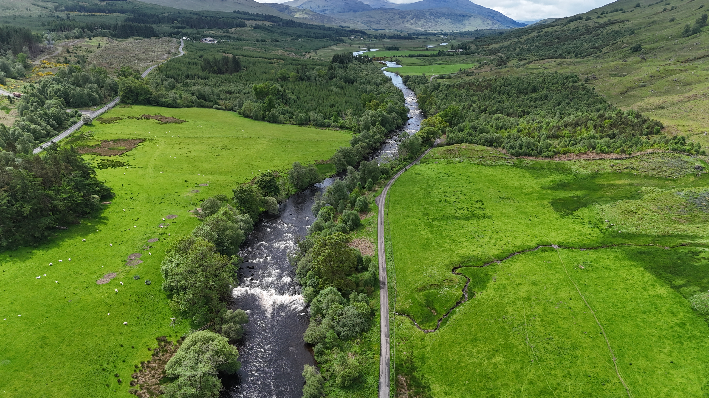

Speaking of Australian things; at both D-town and WOTP, it was a pleasure to see Zac and Maddy in their ascendancy, getting to take their place amongst incredible dancers/instructors from the US and Europe. Zac took charge of the leaders for the 'leads vs follows' dance battle, facing off against last year's winner, Savannah. And I am pleased to share that we (the leads) won handsomely in the dance-off, which I am hoping the video of it gets shared.

Zac asked me on the last night of WOTP about my favourite dances of the trip and shout out to [Helene J Mickle](https://www.instagram.com/helenejooo). I only realised that it was Helene that I had danced with after the fact but those two back-to-back dances on the Sunday night of Neverland Swing were just pure flow-state musicality. A total delight.

Another "WOTP special" is the shirt-signing game on the first night, where you must dance with as many different people in three hours as possible, and get them to sign your shirt. I got close enough to the top, with 48 dances in three hours (with five rest songs and one double up with Jodi), to win my very own collectable WOTP lollipop (the winner did a baffling 56 dances, I don't know where they got the two extra dances from?!).

I cannot write about WOTP without paying homage to the palpable love and energy that you can see poured into the event. Maxence is like the avatar of that energy; this whole trip was my first experiences (at Crossflow, D-town and WOTP) of him and Virginie. I really enjoyed their teaching, heart and energy.

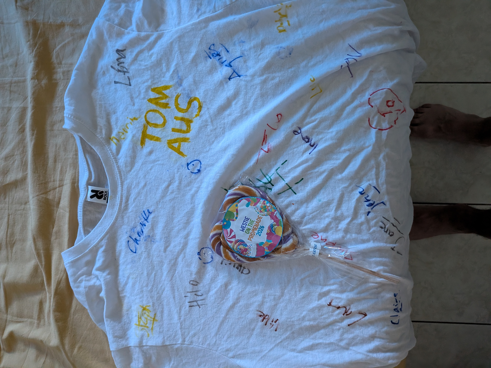

## The return home

Like all good odysseys, I finally returned home. Revitalise was a lovely homecoming, getting to dance with all of the Australian community again. Fittingly, Revitalise de facto took the place in the Aussie calendar of another event called.... "Odyssey"! So there is some poetry there and maybe a [Ship of Theseus](https://en.wikipedia.org/wiki/Ship_of_Theseus) gag. While I didn't get to participate as much as I would have liked (jet-lag and a farewell took me away during part of the event), it was amazing to see the event going from strength to strength in its second year. Amazing that we got over 300 dancers together at an Aussie event and the first tier 5 division (for novice follows) in Australia's event history.

I'm glad to be home, with some sense of routine. But like any good addict, it won't be long before I'm on the road again (The Open, TAP, Santa Swing in Poland, Swingvester in Austria for NYE, and finally BudaFest... here I come! Don't need no AC in winter!!!)

